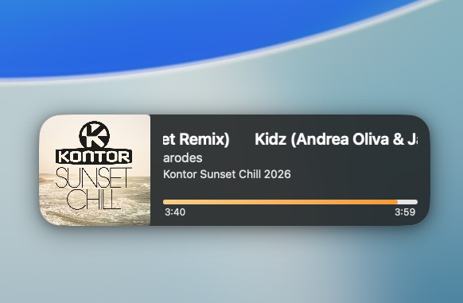
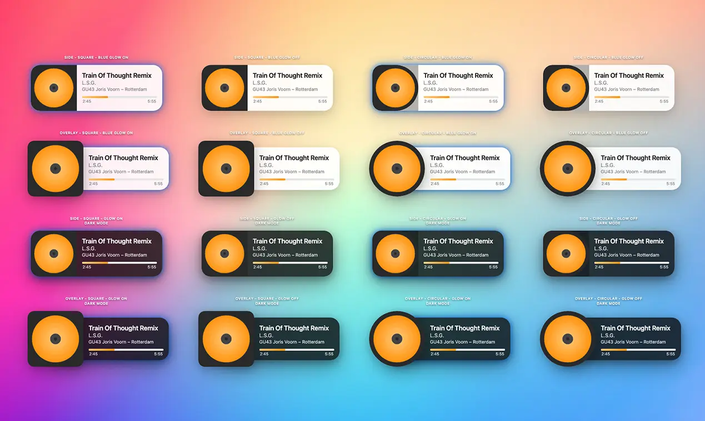
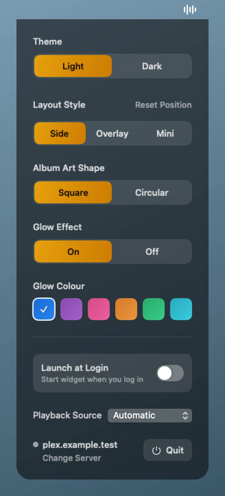

<div align="center">
  

  # NowPlaying for Plex

  [](https://github.com/impactcrew/nowplaying-for-plex/releases/latest)
  [](#requirements)
  [](#building-from-source)
  [](LICENSE)
</div>

A Swift macOS menu bar app that shows the music playing on your Plex server, with album art and track details in a floating widget. The widget displays playback information. Use your Plex player to control playback. The macOS app is the maintained version of this project.



### Onboarding


### Customization Options


### Settings Panel


## Features

- **Mini mode** - A compact option for smaller screens
- **Menu Bar Integration** - Five-bar icon for quick access to settings
- **Beautiful Album Art** - Displays high-quality album artwork with customizable shapes (square, rounded, circle)
- **Smooth Track Transitions** - Album art persists during track changes for seamless playback experience
- **Playback source** - Follow a Plex user or player, or let the widget select an active music session
- **Secure authentication** - Connection settings and token are stored in macOS Keychain
- **First-run Onboarding** - Easy setup with guided onboarding and connection validation
- **Customizable Appearance** - Theme (Light/Dark), Layout (Side/Overlay), Glow colors
- **Universal Binary** - Optimized for both Intel and Apple Silicon Macs
- **Hidden from Sound Menu** - Doesn't clutter macOS sound menu (Plex already shows there)

## Installation

### Download the disk image

1. Choose a release identified as signed and notarized on the [Releases page](https://github.com/impactcrew/nowplaying-for-plex/releases).
2. Open `NowPlaying-for-Plex.dmg` and drag **NowPlaying for Plex** into **Applications**.
3. Open the app and connect it to your Plex server.

Older downloads may predate Developer ID signing. If no signed download is listed, build from source.

## Requirements

- macOS 13.0 (Ventura) or later
- Compatible with both Intel and Apple Silicon Macs (Universal Binary)
- Active Plex Media Server
- Plex account with authentication token

## Configuration

On first launch, the widget will guide you through a simple onboarding process:

1. **Server URL** - Enter your Plex server address. HTTPS is the default. For a trusted local server that only serves HTTP, enter the full `http://` URL and enable **Allow HTTP on my local network**. Remote connections require HTTPS.
2. **Authentication Token** - Provide your Plex authentication token
3. **Local network** - Allow access if macOS asks. To change that choice later, open **System Settings > Privacy & Security > Local Network**. [Apple's Local Network guide](https://support.apple.com/en-gb/guide/mac-help/mchla4f49138/mac)

To get your Plex token, see [Plex's official guide](https://support.plex.tv/articles/204059436-finding-an-authentication-token-x-plex-token/).

## Settings

Access settings from the menu bar icon to customize:

- Theme (Light/Dark)
- Layout (Side/Overlay)
- Album art shape (Square/Circular)
- Glow (on/off, color: blue, purple, pink, orange, green, cyan)
- Playback Source (Automatic, a Plex user, or a player)

## Architecture

Built with modern Swift and SwiftUI:

- **SwiftUI** - Declarative UI framework
- **Combine** - Reactive programming for real-time updates
- **Keychain Services** - Secure credential storage
- **NSWorkspace** - App monitoring and detection
- **UserDefaults** - Settings persistence

## Building from Source

### Prerequisites

- Xcode 26.6 or later with Swift 6.2 or later
- A Mac running a version of macOS supported by that Xcode release

### Build Instructions

```bash
# Clone the repository
git clone https://github.com/impactcrew/nowplaying-for-plex.git
cd nowplaying-for-plex/NowPlayingForPlex

# Run the build script (creates universal binary)
./build.sh
```

The local app is at `NowPlayingForPlex/build/NowPlaying for Plex.app`. See the [contributor guide](CONTRIBUTING.md#testing) for tests and the [release process](CONTRIBUTING.md#direct-download-releases) for distribution builds.

## Development

### Project Structure

```
NowPlayingForPlex/
├── NowPlayingForPlex/
│   ├── NowPlayingForPlexApp.swift # Main app entry point
│   ├── ContentView.swift          # Main widget view
│   ├── OnboardingView.swift       # First-run setup
│   ├── SettingsView.swift         # Settings panel
│   ├── NowPlayingView.swift       # Now playing display
│   ├── PlexAPI.swift              # Plex API integration (display only)
│   ├── Config.swift               # Configuration manager
│   ├── MediaRemoteController.swift # Media remote integration (legacy)
│   ├── PlexAppMonitor.swift       # App detection
│   ├── LaunchAtLogin.swift        # Launch on login helper
│   └── WidgetSettings.swift       # Settings model
└── Assets.xcassets/               # Icons and resources
```

### Contributing

Contributions are welcome! Please feel free to submit a Pull Request.

1. Fork the repository
2. Create your feature branch (`git checkout -b feature/amazing-feature`)
3. Commit your changes (`git commit -m 'Add amazing feature'`)
4. Push to the branch (`git push origin feature/amazing-feature`)
5. Open a Pull Request

## Troubleshooting

### Widget Not Showing

- Ensure Plex is playing music and check the Playback Source setting
- Check that your Plex server is accessible
- Verify server URL and token are correct in settings
- Check Console.app for error logs (filter by "NowPlaying")

### Gatekeeper Warning

If macOS refuses to open a download, check that the release is marked signed and notarized. Report a refusal for a signed release through GitHub Issues.

### App Crashes During Onboarding

- This issue has been fixed in v1.0.0
- If you're using an older version, please update to the latest release
- If crashes persist after updating, please report in GitHub Issues with crash logs from: `~/Library/Logs/DiagnosticReports/NowPlaying*`

## Privacy

This app:

- Stores your Plex token securely in macOS Keychain
- Communicates only with your specified Plex server
- Does not collect or transmit any usage data
- Does not require internet access beyond your Plex server

## Recent Updates

- **v1.4.0** - New Amber branding and a redesigned installer. Playback Source lets you follow a Plex user or player. This update also restores dragging, remembers the widget position, and keeps short track text still. If you’re upgrading directly from v1.0.0, enter your Plex server address and token again during setup.

- **v1.3.0** - Reduced polling and animation work during playback
  - Replaced infinite scroll animations with discrete animation cycles
  - Implemented adaptive API polling (5s playing, 10s paused)
  - Timer stops completely when playback paused
  - Fixed LoadingView animation cleanup

- **v1.0.0 Release** - Fixed critical onboarding crash, added local network support
- **Improved threading** - Resolved @MainActor threading issues with network I/O
- **Smooth track transitions** - Album art now persists during track changes (no flicker)
- **Seamless onboarding** - Smooth window transition instead of app termination
- **Universal Binary** - Native support for both Intel and Apple Silicon Macs
- **Menu bar quit button** - Added quit option in settings panel
- **Hidden from sound menu** - No longer appears in macOS sound menu

## Known Limitations

The widget displays Plex music sessions. Playback remains in the Plex player.

## License

This project is licensed under the MIT License - see the [LICENSE](LICENSE) file for details.

## Disclaimer

This is an unofficial, third-party application and is not affiliated with, endorsed by, or associated with Plex Inc. in any way. All Plex trademarks and logos are the property of Plex Inc.

Artist and album names shown in screenshots are for demonstration purposes only and do not imply endorsement by the respective artists or labels.

## Acknowledgments

- Built for the [Plex](https://www.plex.tv/) community
- Designed & Developed by [IMPACT Crew](https://impactcrew.com.au)

---

<div align="center">

**Made for the macOS community**

</div>
